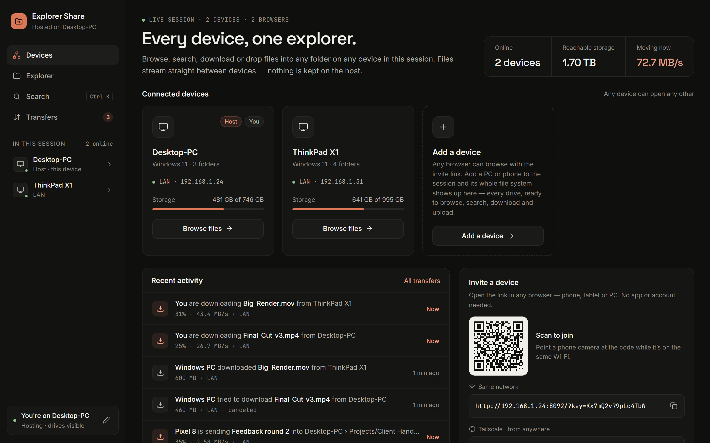
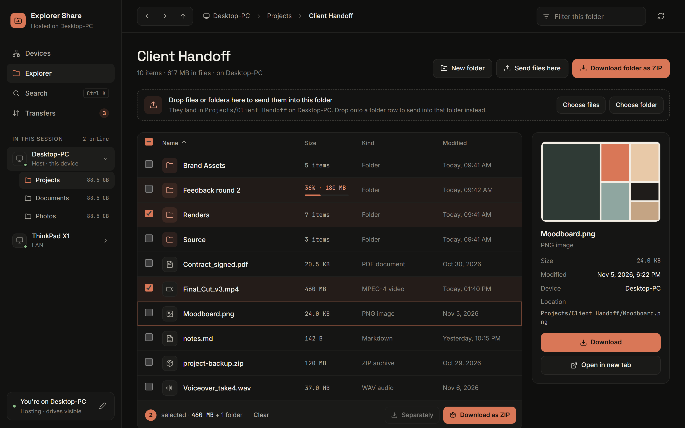
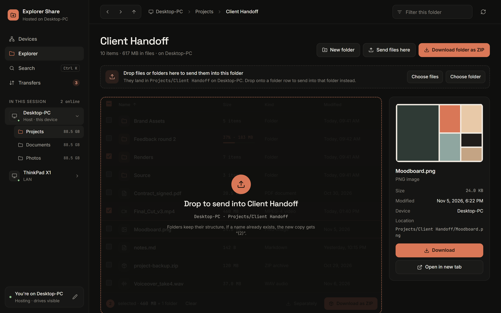
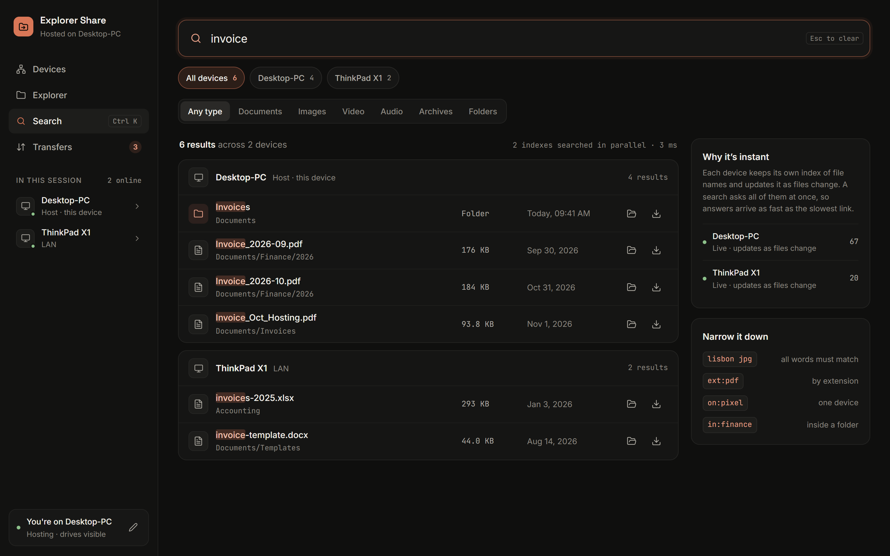
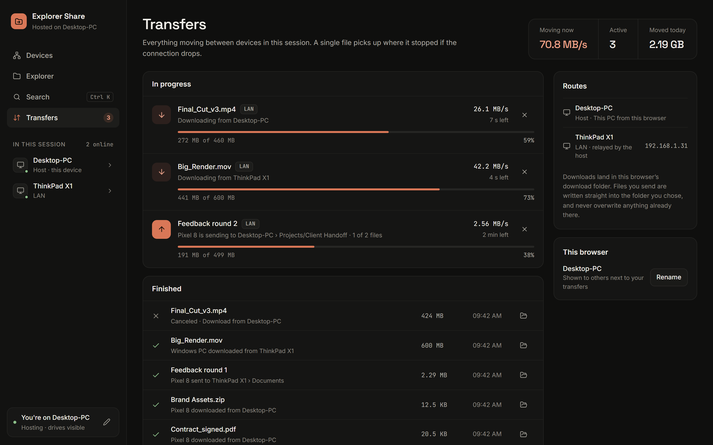
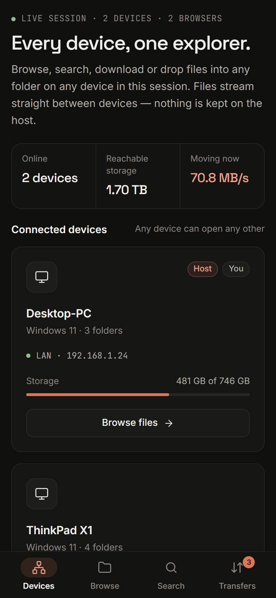
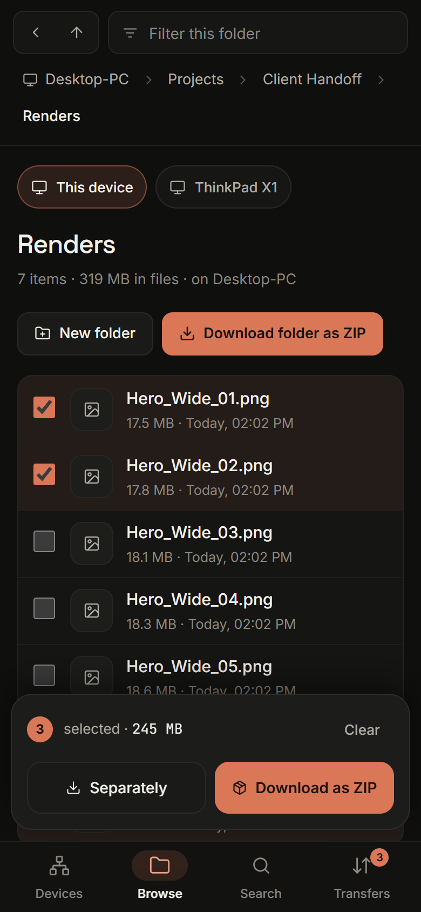
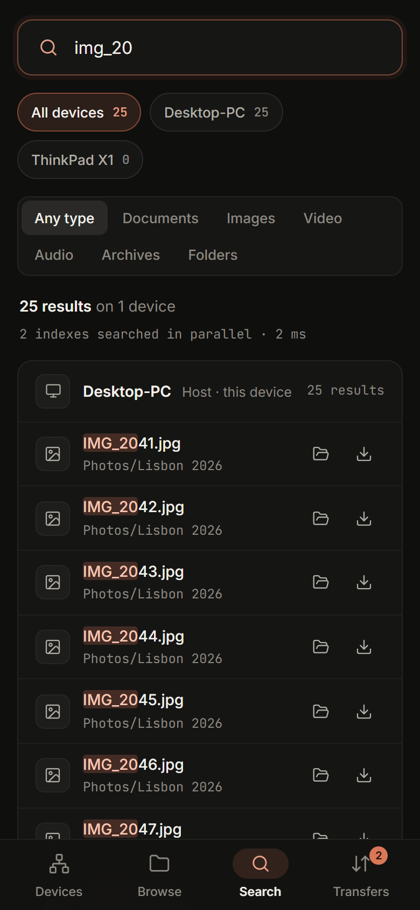

<h1 align="center">Explorer Share</h1>

<p align="center">
  <b>Every device's files in one explorer.</b><br>
  Browse, search, download and upload across every PC and phone you own — on your home Wi-Fi, or from anywhere over Tailscale.
</p>

<p align="center">
  
</p>

Start it on one PC. Every device you add to the session shows **its whole file system** — all drives on a PC, internal storage and SD card on Android — and anyone in the session can:

- **Browse** any folder on any device, with previews for images, video, audio and text
- **Search** every device at once — a million file names answer in milliseconds
- **Download** single files (resumable) or any mix of files and folders as one ZIP
- **Upload** files or whole folders from wherever they are into the exact folder you're looking at, on any device

There is nothing to pick or share. Being in the session is the permission.

## Screenshots

**Explorer** — select anything, preview files, see uploads arriving live.



**Drop to upload** — drag files or folders from your computer onto any folder, on any device. Folder structure and dates are kept; nothing is ever overwritten.



**Search every device at once** — each device keeps its own live index, and every index is asked in parallel.



**Transfers** — everything moving in the session, with live speed, time left and cancel.



**On a phone** — the same app, laid out for one hand.

<table>
  <tr>
    <td width="33%"></td>
    <td width="33%"></td>
    <td width="33%"></td>
  </tr>
</table>

## Quick start

On the PC that will host the session:

1. Install [Node.js](https://nodejs.org) 20.15 or newer.
2. Download this repository and double-click **`start.bat`** (or run `npm install` then `npm start`).
3. The console prints the **invite link** and a QR code. Open it on any phone, tablet or PC — on the same network, or through the Tailscale address it also prints.

The host's own browser opens automatically and never needs the link.

> **Windows Firewall:** the first time, allow Node.js on **Private networks**. If other devices can't connect, that's almost always why.

## Add another device's files

Any browser with the invite link can browse, search, download and upload. To make a device's **own** files visible too, add it to the session — the Devices page has everything:

| Device | How |
|---|---|
| **Windows PC** | Open the invite link there → **Devices** → **Join kit**. Unzip, double-click **`Join session.bat`**. The kit carries its own Node.js, so nothing needs installing. Close the window to leave. |
| **Android** | Install **Termux** from F-Droid. Copy the Android command from the Devices page, paste it into Termux and allow storage access. Internal storage and the SD card become visible. Ctrl+C to leave. |
| **Any machine with this repo** | `node server/index.js --join "<invite link>"` |

Joined devices reconnect on their own if the host restarts or the Wi-Fi drops.

## How it works

```
 phone / laptop browser ──┐                    ┌── joined PC  (agent)
                          │  HTTP + WebSocket  │
 another browser ─────────┼──────  HOST  ──────┼── Android / Termux  (agent)
                          │  web app · hub ·   │
 host's own browser ──────┘  its own drives    └── …
```

- **Hub and agents.** The host serves the web app and holds one WebSocket to every joined device. Commands — list, search, read, write — travel over it; file bytes travel over plain HTTP through the host. Only the host needs to be reachable, which is why the same setup works on the LAN and over Tailscale.
- **Search.** Each device indexes its own file names in the background, reading directories only. Lower-cased names are packed into large text blocks and scanned with native string search, so a million names answer in a few milliseconds. A recursive file watcher keeps it current within seconds on Windows and macOS. A query goes to every device at once.
- **Downloads.** Single files support HTTP Range, so interrupted downloads resume. Folders and multi-selections stream as a ZIP64 archive whose exact size is known before the first byte — real progress, no temp files, no 4 GB limit.
- **Uploads.** Each file is written to a hidden `.part` file and renamed when complete, so a cut-off transfer never leaves a broken file. A name clash becomes `name (2).ext`. Folder structure and modified dates are kept.

## Security

- The session is private to people with the invite link. Its key is stored as a cookie, persists across restarts, and can be rotated with `--new-key`. The host PC itself never needs it.
- **Anyone in the session can read and write every visible drive on every device.** Only invite your own devices. `--only <folder>` limits what a device shows.
- Paths are confined to their drive (`..` is refused), host names are checked against DNS rebinding, file previews run in a sandbox so a shared `.html` or `.svg` can't script the app, and WebSockets must come from the app's own page.

## Options

```
node server/index.js [--port 8080] [--name "Desktop-PC"] [--no-open] [--open-access] [--new-key] [--only <folder>]…
node server/index.js --join "<invite link>" [--name "ThinkPad"] [--only <folder>]…
```

| Option | |
|---|---|
| `--name` | How the device appears (default: the computer name) |
| `--only <folder>` | Show only these folders instead of the whole device (repeatable) |
| `--port` | Port for the host (default 8080; the next free one is used if taken) |
| `--no-open` | Don't open a browser on the host |
| `--open-access` | No key at all — anyone who can reach the address gets in (trusted networks only) |
| `--new-key` | Rotate the invite key; joined devices need the new link |

## Project layout

```
start.bat              host launcher (closing its window ends the session)
server/index.js        CLI: host mode, or agent mode with --join
server/hub.js          devices, browser tabs, transfers, byte pipes to agents
server/device.js       one interface for the host's files and joined devices
server/agent.js        agent side: answers the hub, streams bytes over HTTP
server/localfs.js      drives, safe paths, listing, reading, atomic writes
server/nameindex.js    the fast file-name index
server/routes.js       HTTP API, downloads, ZIPs, uploads, join kit
server/zip.js          streaming ZIP64 writer with precomputed length
public/                the web app — plain ES modules, no build step
```

## Not yet

Delete and rename, copying directly between two other devices, and a grid view.
